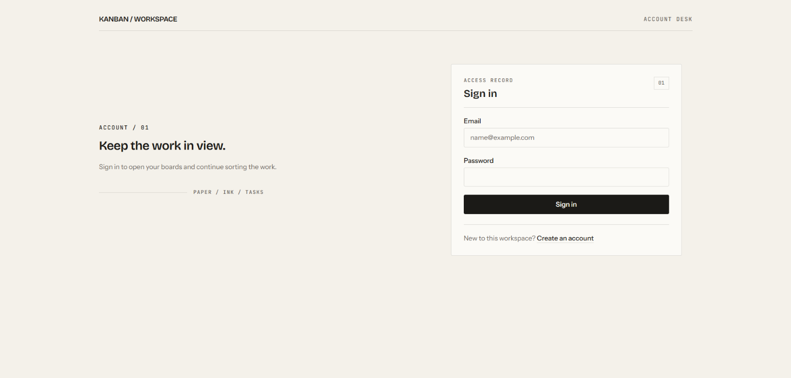
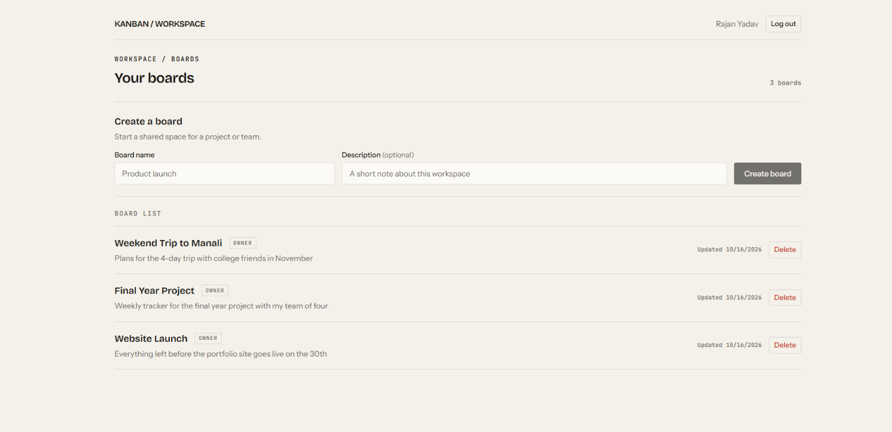
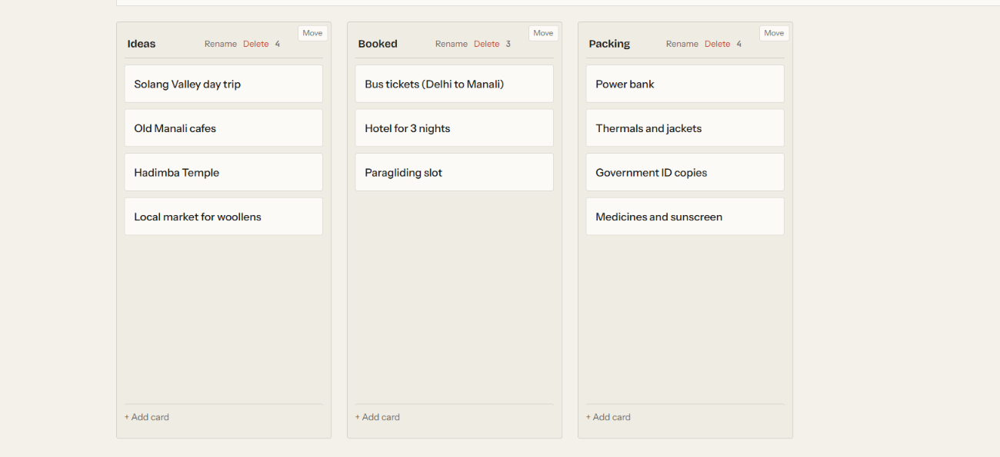
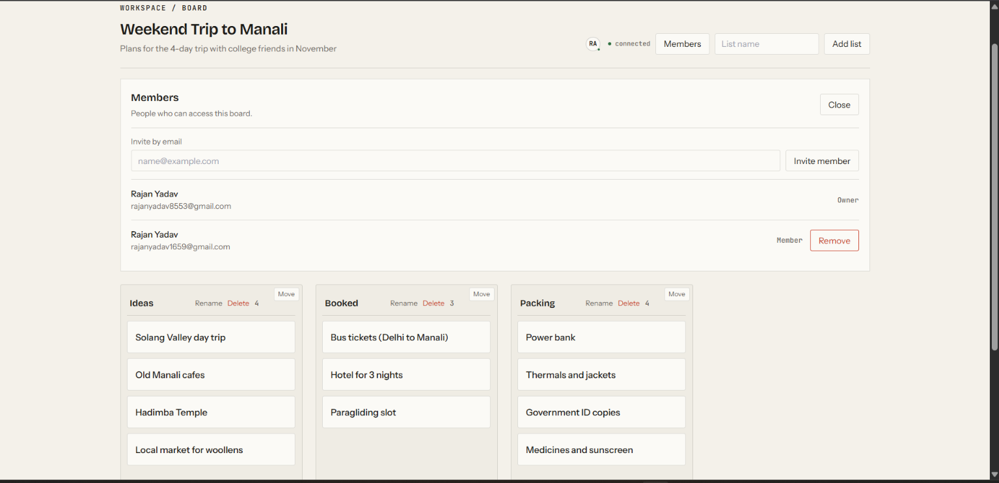
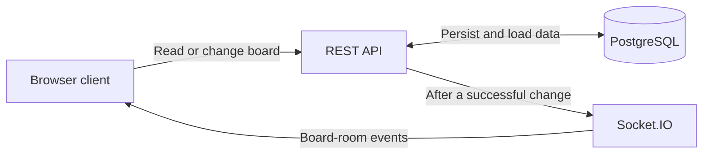

# Real-Time Collaborative Kanban Board

A web application for organizing board work into lists and cards, with board updates and member presence shared in real time.

## Live demo

[Open the live demo](https://real-time-kanban-board-alpha.vercel.app)

Demo login: [demo@123gmail.com] / [Demo@123]

The backend runs on a free tier and may take up to a minute to wake on the first request.

## Features

- Register and sign in.
- Create boards and manage board members with owner and member roles.
- Create, rename, and delete lists; create, edit, move, and delete cards.
- Drag and drop cards to reorder them or move them between lists.
- Receive board changes and online presence updates through Socket.IO.
- Rejoin the board room and reload the board after a socket reconnects.

## Screenshots

| Sign in | Boards dashboard |
| --- | --- |
|  |  |

| Board | Board members |
| --- | --- |
|  |  |

## How real-time sync works

The client loads and changes board data through the REST API. After a successful change is saved to PostgreSQL, the server publishes a Socket.IO event to the board room; other clients update their board state from that event. The client authenticates its socket connection and must be a current board member to join; after reconnecting, it rejoins and fetches the board again.



## Tech stack

The following choices and rationales are recorded in [docs/DECISIONS.md](docs/DECISIONS.md).

| Technology | Reason for this choice |
| --- | --- |
| Socket.IO | Board rooms scope broadcasts, and reconnection support handles interrupted connections. |
| PostgreSQL | Relational constraints and transactions fit the board, membership, list, and card data model. |
| Prisma | The schema generates TypeScript types, and Prisma Migrate manages versioned schema changes. |
| JSON Web Tokens (JWT) | A signed token authenticates both REST and Socket.IO without a separate server-side session store. |

## Design decisions

### Fractional card ordering

Cards use numeric positions, with a midpoint position for an insertion between two existing cards. If there is no usable gap, the server rebalances positions before choosing one.

### Last-write-wins, with the server as authority

The server persists accepted changes to PostgreSQL and broadcasts the resulting state to board members. The client applies optimistic updates, rolls them back when a request fails, and reloads the board after reconnecting.

### Socket authorization

The socket handshake verifies the user's token, and joining a board room requires current membership. Leaving is limited to a room the socket has joined, and the server rechecks room members before broadcasting.

## Security

- Helmet sets standard HTTP security headers.
- REST and Socket.IO CORS accept the configured `CLIENT_ORIGIN`.
- JSON request bodies are limited to 1 MB; malformed and oversized bodies receive errors.
- Registration and login are limited to 20 requests per IP in a 15-minute window.
- Protected REST routes and socket handshakes require a valid JWT; the server reloads the user from the database when verifying the token.
- Zod validates REST path parameters and request bodies, as well as socket join and leave payloads.
- Board membership is required for board access, and owner-only changes check the owner role.
- Before publishing to a board room, the server rechecks members and removes sockets whose membership has ended.
- `JWT_SECRET` and database connection strings are read from environment variables.

## Run locally

### Docker Compose

With Docker Compose installed, run this from the repository root:

```sh
docker compose up --build
```

Open the client at <http://localhost:8080>. The API and Socket.IO server are available at <http://localhost:5001>. Compose starts PostgreSQL, applies Prisma migrations when the server starts, and waits for healthy services before starting the client. Stop the services with `docker compose down`.

### Manual setup

Use Node.js 22 and a running PostgreSQL database. Copy the server environment template, then edit `server/.env` with valid database URLs, a JWT secret, and `CLIENT_ORIGIN` set to `http://localhost:5173`:

```powershell
Copy-Item server\.env.example server\.env
```

In one terminal, install the server dependencies, apply migrations, and start the API:

```powershell
Set-Location server
npm ci
npm run migrate
npm run dev
```

In another terminal, install and start the client:

```powershell
Set-Location client
npm ci
npm run dev
```

Open <http://localhost:5173>. Vite proxies API and Socket.IO traffic to `http://localhost:5000`.

### Environment variables

| Server variable | Purpose |
| --- | --- |
| `DATABASE_URL` | PostgreSQL connection used by the application. |
| `DIRECT_URL` | Direct PostgreSQL connection used by Prisma migrations. |
| `JWT_SECRET` | Secret used to sign and verify access tokens. |
| `CLIENT_ORIGIN` | Browser origin allowed by REST and Socket.IO CORS. |
| `PORT` | Port used by the server. |
| `TRUST_PROXY_HOPS` | Number of trusted reverse-proxy hops. |

| Client variable | Purpose |
| --- | --- |
| `VITE_API_BASE_URL` | Base URL for REST requests. |
| `VITE_SOCKET_URL` | Socket.IO server URL. |

The client variables are optional for local development: the client defaults to `/api/v1` for REST, and to the current page origin for Socket.IO.

For Docker Compose, set `POSTGRES_USER`, `POSTGRES_PASSWORD`, and `POSTGRES_DB` in a root `.env` file to configure PostgreSQL. By default, Compose publishes the API on port 5001 and the client on port 8080.

## Project structure

```text
client/
  public/               Static assets
  src/                  React app, API client, auth, board pages, socket provider
  Dockerfile
server/
  src/                  Express app, routes, controllers, services, socket server
  prisma/               PostgreSQL schema, migrations, and seed
  tests/                API and Socket.IO integration tests
  Dockerfile
docs/
  screenshots/          Board, dashboard, login, and members PNGs
  *.md                  Architecture, security, deployment, and project docs
.github/workflows/ci.yml
docker-compose.yml
```

## Tests and CI

Client tests cover invalid login input, card creation from the inline composer, the empty-board state, owner member management, and an invite for an unknown email. Server integration tests cover registration, duplicate registration, login, unauthenticated access, board membership and owner-only deletion, ordered card moves, and Socket.IO card-move delivery to a member while denying a non-member room join.

The [CI workflow](.github/workflows/ci.yml) runs on pushes and pull requests targeting `main`. It installs dependencies, runs client and server linting, typechecks and tests, builds both packages, and builds both Docker images.

[](https://github.com/rajanxweb/real-time-kanban-board/actions/workflows/ci.yml)

## Known limitations

- The deployed backend runs on a free tier and may take up to a minute to wake on the first request.
- Concurrent edits use last-write-wins behavior; the app does not merge simultaneous text edits character by character.

## License

This project is licensed under the MIT License. See [LICENSE](LICENSE).
