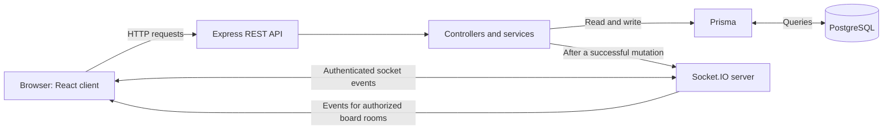

# Real-Time Collaborative Kanban Board

A full-stack Kanban board where teams organize work into lists and cards and see board changes and online presence update live.

**Live demo:** [Open the live demo](https://your-live-demo-url.example)


## Features

- Register and sign in, then create and manage boards.
- Create, rename, reorder, and delete lists; create, edit, move, and delete cards.
- Drag cards between lists and reorder lists with pointer or keyboard controls.
- See other board members' online presence and receive board changes in real time.
- Apply optimistic changes in the interface; roll back rejected changes and reload board data after reconnecting.
- Get loading, empty, and error states on the board and dashboard.

## Tech stack

- **Client:** React, TypeScript, Vite, Tailwind CSS, TanStack Query, dnd-kit
- **Server:** Node.js, Express, TypeScript, Socket.IO, Zod
- **Data:** PostgreSQL, Prisma ORM
- **Tests:** Vitest, React Testing Library, Supertest
- **Containers:** Docker Compose, with PostgreSQL, the API, and the static client

## Architecture



The client loads board data and submits changes through the REST API. Socket.IO handles board-room updates and presence. Both paths use the same server and PostgreSQL database.

## How real-time sync works

The client connects to Socket.IO with its JWT and requests to join a board room; the server checks current board membership before joining. A board change is validated and saved through the REST API before the server broadcasts an event to that board's room. Other clients apply the event to their cached board state. The acting client updates optimistically and rolls back if the request fails; after reconnecting, it fetches the board again to reconcile its state.

## Security highlights

- JWT authentication protects API routes and is checked during the Socket.IO connection handshake.
- Zod validates request bodies, path parameters, and socket payloads.
- Board membership and owner permissions are checked on protected operations; room membership is rechecked before broadcasting.
- Passwords are stored as hashes. Authentication routes are rate-limited.
- Helmet sets HTTP security headers, CORS is limited to the configured client origin, and JSON request bodies are limited to 1 MB.
- Secrets are supplied through environment variables. Do not use the Docker Compose default credentials outside local development.

## Run with Docker

Install Docker with the Compose plugin, then run from the repository root:

```sh
docker compose up --build
```

Open <http://localhost:8080>. The API and Socket.IO server are published at <http://localhost:5001>. Compose starts PostgreSQL, applies Prisma migrations, and serves the client after the API is healthy. PostgreSQL is available to the other Compose services, not published on a host port.

For local testing, Compose defaults to `postgres` credentials and generates a temporary JWT secret if `JWT_SECRET` is unset. Set `POSTGRES_PASSWORD` and `JWT_SECRET` before using the stack in a shared environment. `CLIENT_PORT` and `SERVER_PORT` change the host ports. Stop the services with `docker compose down`; the database volume remains in place.

## Run manually

Use Node.js 22 and a running PostgreSQL database. In PowerShell, copy the server environment template and edit its database connection values and JWT secret:

```powershell
Copy-Item server\.env.example server\.env
```

Set `CLIENT_ORIGIN` to `http://localhost:5173`. Set `DATABASE_URL` to the application database connection and `DIRECT_URL` to a direct connection Prisma can use for migrations. Keep both values private.

In one terminal, install the server dependencies, apply migrations, and start the API:

```powershell
Set-Location server
npm ci
npm run migrate
npm run dev
```

In a second terminal, start the Vite client:

```powershell
Set-Location client
npm ci
npm run dev
```

Open <http://localhost:5173>. Vite proxies API and Socket.IO traffic to `http://localhost:5000` during development.

## Environment variables

| Variable | Used by | Required or default | Purpose |
| --- | --- | --- | --- |
| `DATABASE_URL` | Server, Prisma | Required | PostgreSQL connection used by the application. |
| `DIRECT_URL` | Prisma CLI | Required for migrations | Direct PostgreSQL connection used by Prisma migrations. |
| `JWT_SECRET` | Server | Required; Docker can generate a temporary local value | Signs and verifies access tokens. |
| `CLIENT_ORIGIN` | Server | Required | Exact browser origin allowed by HTTP and Socket.IO CORS. |
| `PORT` | Server | `5000` | Port the API and Socket.IO server listens on. |
| `TRUST_PROXY_HOPS` | Server | `0` | Number of trusted reverse-proxy hops. Set to match the hosting environment. |
| `POSTGRES_USER` | Docker Compose | `postgres` | Local PostgreSQL user. |
| `POSTGRES_PASSWORD` | Docker Compose | `postgres` | Local PostgreSQL password; replace outside local development. |
| `POSTGRES_DB` | Docker Compose | `kanban` | Local PostgreSQL database name. |
| `SERVER_PORT` | Docker Compose | `5001` | Host port published for the API and Socket.IO server. |
| `CLIENT_PORT` | Docker Compose | `8080` | Host port published for the client. |
| `VITE_API_BASE_URL` | Client build | `/api/v1` in development | Base URL for REST requests. |
| `VITE_SOCKET_URL` | Client build | Current page origin | Socket.IO server URL. |

## Project structure

```text
client/
  src/                 React app, API client, auth, board pages, socket provider
  Dockerfile           Client build and Nginx runtime image
server/
  src/                 Express app, routes, controllers, services, socket server
  prisma/              Database schema, migrations, and seed
  tests/               API and real-time integration tests
  Dockerfile           Server build and runtime image
docs/                  Architecture, API, security, deployment, and test docs
docker-compose.yml     Local PostgreSQL, server, and client services
```

## Key design decisions

The project uses REST for authenticated reads and mutations, then broadcasts successful changes over Socket.IO to authorized board rooms. PostgreSQL and Prisma store the canonical state; fractional positions support list and card ordering without rewriting every item for each move. JWTs avoid a separate session store, while server-side membership checks control board access. See [docs/DECISIONS.md](docs/DECISIONS.md) for the trade-offs and rationale.
